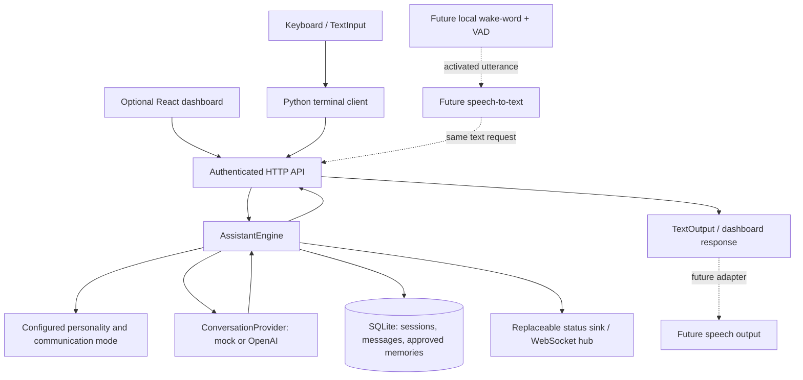

# V1 architecture

FRED is a headless Python service with replaceable transports and providers. The
same application runs on a Windows development PC and a Linux mini PC; moving
between them changes installation, service supervision, paths, and configuration.
The reasoning and persistence modules have no desktop or audio-driver dependency.

## Component responsibilities

| Component | Boundary and responsibility |
| --- | --- |
| Core engine | Validates text and owner/session scope, persists the submitted turn, bounds context, applies exact style commands, invokes a replaceable provider, saves a verified text reply, and emits processing status |
| Input/output | `TextInput` and `TextOutput` protocols with keyboard/console adapters; the authenticated terminal client translates explicit commands into API operations |
| Model/personality | `ConversationProvider.complete` receives bounded text context; configurable owner display name, personality guidance, and communication mode are independent of provider selection |
| Memory | Owner-scoped SQLite records and bounded retrieval; long-term facts require explicit approval and remain inspectable, correctable, exportable, and removable |
| Configuration | Typed environment settings, feature flags, future room/device declarations, and isolated voice hardware/timeouts settings |
| Service lifecycle | `services/lifecycle.py` supplies `ServiceManager`: configuration validation, schema/owner preparation, provider initialization, health/readiness, structured audit/status reporting, and shutdown cleanup |
| Integrations/permissions | Data contracts, validated registry, explicit action allowlists, and deterministic authorization; no live executor is registered |

The terminal talks to the service instead of opening a second database/engine.
Both dashboard and terminal therefore share session ownership, saved model/mode,
provider behavior, memory rules, errors, and audit events. Future transcribed input
must enter that same text boundary; it must not bypass authentication or policy.
Each protocol can be replaced with an in-memory test adapter. HTTP transports and
temporary databases make core/client tests independent of credentials and hardware.

## Conversation and failure flow

1. The API authenticates the owner, checks CSRF for mutations, validates request
   shape, and applies rate limits.
2. The engine validates owner/session scope and accepts one active turn per service
   worker. It persists the user message before provider work.
3. It selects a bounded recent history and relevant explicitly approved memories.
   Retrieved memory is labeled untrusted reference data, never instruction authority.
4. Exact communication-mode commands update preferences without calling a model.
   Other turns invoke the configured provider and persist a nonempty text response.
5. Status reports thinking, idle, or error. Provider errors are actionable and do
   not trigger a silent mock fallback. A failed/cancelled turn retains its submitted
   user message and does not invent an assistant reply.

Core shutdown stops accepting new turns and cancels/drains active engine work
before releasing provider/storage resources. A terminal interruption is not a
promise of remote request cancellation: check history before retrying. Production
load, multiple workers, distributed queues, and an end-user cancellation endpoint
are outside V1.

## Persistence and privacy

SQLite stores conversations/messages, owner preferences, approved memories,
expiring hashed session tokens, and audit records. The default database path is
root-relative and survives service restarts. Schema creation is an initial V1
mechanism, not a versioned migration system. Backup/restore uses SQLite's online
backup API; do not copy a live database file casually or move a virtual environment
between Windows and Linux.

Message and memory contents, passwords, tokens, and provider responses are excluded
from application audit logs. Audit metadata can still be private. Mock inference
is entirely local and deterministic. Live OpenAI inference receives selected
conversation/memory context; disabling chat memory retrieval preserves inspection/edit/delete/export of old records.
No personal name or real business record is required in source configuration.

## Future voice boundary

Contracts cover local-only `Hey Fred` wake-word detection, voice activity detection,
activated-utterance transcription, speech synthesis, playback stop/cancellation,
microphone/speaker selection, and supported echo cancellation. Timeouts and device
IDs belong to configuration. No continuous ambient audio is streamed to a cloud
provider. A future controller must make listening/recording/mute states explicit,
submit transcripts through the existing text pipeline, and stop inference/playback
on interruption. V1 installs no audio drivers, wake models, or speech runtime.

## Future devices and computer agents

Rooms and device definitions are configuration data with validated identities and
room references. Their kinds cover lights, plugs, sensors, thermostats, and computer
endpoints. Definitions and planned integration status never establish connectivity.
Future Home Assistant and computer adapters must authenticate their transport,
report real status, and apply deterministic action/device allowlists. Sensitive
operations need a separately verified confirmation bound to the intended action;
text from a model or retrieved memory cannot grant permission. No general-purpose
shell execution path is exposed to the model.

Keep these adapters outside the core. First prove one narrow operation and its
denial/failure paths, then expand room groups/routines. Remote dashboard/mobile
access requires a deliberate same-origin HTTPS gateway and retained authentication,
CSRF, firewall/VPN controls. It is not enabled by binding a development server to
all network interfaces.

## Deployment boundary

A service supervisor owns reboot/crash restart; the Python application owns
validation, health/readiness, persistent state, and graceful cleanup. The supplied
systemd template is an uninstalled future path, not evidence of tested 24/7
operation. See [deployment and recovery](deployment.md) for least-privilege paths,
backup/restore, target-host validation, and known single-worker limits.
